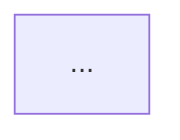

# Engineering Workspace (structure, rendering, opening, walkthrough)

**Load when:** the developer asked to save the work as Markdown docs in the project. SKILL.md decides *when*; this file defines *how*.

**Optional, on request only.** By default the workflow writes no files into the project: diagrams are rendered from `.mmd` files in a session folder outside the project and opened as image tabs, and everything else goes in chat (SKILL.md → *Diagrams*). This saved workspace is for developers who want a persistent, navigable copy. It is explored **entirely inside the editor** — Markdown pages in the native Markdown Preview, diagrams as local SVG images. **Never open an external web browser.**

The diagram rules in §3a (BEFORE/AFTER/delta ids, colours, node-ID stability) apply to the default session diagrams too.

## 1. Location and structure

Default: `<target-project-root>/docs/engineering-intelligence/<task-name>/` where `<task-name>` = `<task>-<subject-slug>` (e.g. `analyze-checkout-flow`, `review-payment-retry`). If the project has its own docs convention, the developer chose at intake. Never write elsewhere. Write only after the developer asked for saved docs, and list the files you'll write. If the folder exists, ask: new folder with a date suffix, or update in place.

| File | Contents | Built from |
|------|----------|------------|
| `index.md` | Title, "Explore this workspace" page table, executive overview, overview diagram, key findings, open questions, how to view | `templates/workspace/index.md` |
| `architecture.md` | Components, layers, dependency diagram, source map | `templates/architecture-diagram.md` |
| `flow.md` | Business-flow overview diagram + step table; links to subflows | `templates/business-logic-flow.md` |
| `flow-<subflow>.md` | One detailed subflow each (complex flows only) | `templates/business-logic-flow.md` |
| `risks.md` | Findings and risks by severity, with source locations | `templates/review-report.md` sections 2–3, 6 |
| `evidence.md` | Evidence classification per finding, summary counts, open questions, unverified assumptions, what was not examined | `references/evidence-model.md` |
| `comparison.md` | Code-changing tasks: BEFORE/AFTER comparison — verdict, delta diagram, BEFORE and AFTER diagrams per flow, step mapping, behavior inventory (§3a) | `templates/workspace/comparison.md` |
| `sources.md` | Every source file referenced, grouped by layer/component, with links and which pages cite it | — |
| `diagrams/<id>.svg` | Self-contained rendered image of each diagram (offline, no scripts) | `scripts/render_workspace.py` |

Task-specific pages go in the same folder: `profile.md` (project-profile), `proposal.md` (architecture-proposal), `review.md` (review-report or engineering-review-report), `behavior-map.md` (large parity inventories; `comparison.md` links it).

No HTML files are part of the workspace. (The render script uses a temporary HTML harness in the temp directory; it is never shown to the developer.)

**Compact mode:** when the whole content is short (roughly < 250 lines), put all sections in `index.md` with anchor links. Split into pages as soon as a section grows large. Never omit a required section — mark it `N/A — <reason>`.

**Required content (any mode):** executive overview · at least one architecture or business-flow diagram · detailed flow breakdown · source-linked steps and components · findings and risks · evidence classification · open questions and unverified assumptions · related files and navigation.

## 2. Navigation (works inside the Markdown Preview)

Navigation must be **visible at the top of the content**, not a small line above the title (tested: a nav line above the H1 is easy to miss in the preview).

- **`index.md`:** directly under the title block, an **"Explore this workspace"** table — one row per page (or anchor in compact mode) with a one-line description. Developers start here.
- **Every other page:** directly under its H1, one bold line:

  ```markdown
  **Workspace:** [← Overview](index.md) · [Architecture](architecture.md) · [Business Flow](flow.md) · [Risks](risks.md) · [Evidence](evidence.md) · [Source References](sources.md)
  ```

  Drop links to pages that don't exist; use anchors in compact mode.
- **Source links:** Markdown links relative to the page, e.g. `[src/cart/validate.ts:40](../../../src/cart/validate.ts#L40)` — from `docs/engineering-intelligence/<task-name>/` the project root is `../../../`. Compute it if the location differs; check each target exists. In the editor preview a source link opens the file in the editor; whether `#Lnn` jumps to the line depends on the editor.
- **Diagram nodes → source:** every important node has a row in the source-map table directly under the diagram, with a Markdown link — this is the reliable click-through inside the editor (SVG images are not clickable).
- **Cross-links:** findings in `risks.md` link to the step/component they concern; `sources.md` lists which pages cite each file.

## 3. Diagram format (source-first)

Per `mermaid-diagrams.md`. Prefer architecture/component diagrams for project understanding, sequence diagrams for interactions and lifecycles, flowcharts for decisions and business logic, state diagrams for entity statuses. Complex flows: overview (≤ ~15 nodes) in `flow.md` + one detailed diagram per subflow page.

The Mermaid source in the Markdown page is the **single source of truth**. Each diagram is marked with an id that becomes its SVG file name:

**Image mode (default — editor preview has no Mermaid support):**

````markdown
### Checkout — overview
<!-- ei:diagram id=flow-overview -->


<details><summary>Mermaid source</summary>



</details>

| Node | Source | Evidence |
|------|--------|----------|
````

**Native mode (only when detection found a Mermaid preview extension, §5):** the marker followed directly by the visible ```` ```mermaid ```` block, and a link `[SVG](diagrams/flow-overview.svg)` instead of the image — the SVG is still generated for offline use and other viewers.

Ids are unique across the workspace (`[A-Za-z0-9_-]`). To change a diagram, edit its Mermaid block and re-run the render script.

## 3a. BEFORE / AFTER comparison (code-changing tasks)

The comparison answers one question for the developer: *did the logic stay the same, and if not, exactly what changed?* It must show the code as it really is after all fixes.

| Diagram | Id | Drawn from | When | Lives in |
|---------|----|-----------|------|----------|
| BEFORE | `before-<name>` | original code (base commit or pre-change copies) | before the Plan Gate; frozen afterwards | `flow.md` / `architecture.md` |
| AFTER | `after-<name>` | final code, re-traced (not the plan) | after the last code change: final review, its fixes, and test-driven fixes are done | `comparison.md` |
| Delta | `delta-<name>` | AFTER structure + MISSING nodes from BEFORE | with AFTER | `comparison.md` |

Rules:
- **Same `<name>`, same node IDs** for a step that still exists, even if it moved to another file — the mapping table shows the new location. A new step gets a new ID; a removed step keeps its ID only in BEFORE (and as a dashed `missing` node in the delta).
- **Delta colours** (classDefs in the template): `preserved` green · `changed` yellow · `added` blue · `missing` red dashed · `unknown` grey dashed. In delta diagrams these replace the evidence classes; evidence stays in the mapping table.
- **Page order** in `comparison.md`: verdict and counts → delta diagram (at a glance) → per flow: BEFORE image, AFTER diagram, step mapping → architecture (or `N/A — no structural change`) → behavior inventory → differences needing a decision. Diagrams are stacked, not side by side (narrow previews).
- **Locations:** BEFORE as plain text `path:line` (those lines may no longer exist); AFTER as links to the current lines.
- **Snapshot binding:** one `<!-- ei:after-hash <path> <sha256|deleted> -->` per Implementation Scope file, written when the AFTER trace is done. The render script (§4) fails with `stale_after` if any file changed afterwards → redraw AFTER, delta, and the mapping.
- **Every one-sided node is classified:** a node ID in only one of `before-<name>` / `after-<name>` must appear in backticks in a mapping table (MISSING, ADDED, moved, or renamed). The script reports `unaccounted_nodes` otherwise.
- `index.md` links `comparison.md` in its page table, and the verdict line is repeated in its executive overview.

## 4. Rendering and verification

Mermaid source alone is not a finished diagram.

### Render
Run, with a temp directory **outside the project** that was named in the output plan:

```bash
python3 -I <skill-dir>/scripts/render_workspace.py <workspace-dir> --tmp <session-temp-dir>
```

- Collects every marked Mermaid block from the workspace pages; renders them with an installed Chromium-family browser running **headless** (no window, throwaway profile — the developer never sees a browser); writes `diagrams/<id>.svg`.
- SVGs are made standalone: no scripts or external references, plain SVG text labels (no `foreignObject`), fixed intrinsic size, white background so they stay readable in dark editor themes. **Viewing needs no network.**
- Rendering needs the Mermaid library: by default a pinned jsDelivr URL fetched by the headless renderer at generation time (state this network use in the output plan), or a local copy via `--mermaid-js <path>`.
- Verifies every `` reference in the pages resolves to a file.
- Writes a check image to the temp dir showing every SVG displayed as an image on a dark background — the way an editor preview shows them.
- Verifies BEFORE/AFTER integrity (§3a): `stale_after`, `broken_after_links`, `unaccounted_nodes`; `before_after_pairs` lists the node IDs present on only one side per pair. Project root: `--project <root>` (default: three levels above the workspace).
- `--check-only` re-verifies markers, references, and BEFORE/AFTER integrity without rendering (offline) — run it right before G3 and after any late change.

Results:
- `render_errors` / `source_problems` → fix the Mermaid source in the page and re-run. Never deliver a diagram that failed to render.
- `stale_after` / `broken_after_links` → the AFTER pages no longer describe the code: re-trace, redraw, update hashes. `unaccounted_nodes` → classify each listed node in the mapping table (verify by reading both sides).
- `not_run` → no headless-capable browser or the Mermaid library couldn't load; try `mmdc` if already installed (never install it); else report.
- On `ok`, **read the check image** and confirm each diagram is visible and legible. Then the SVGs are `RENDERED — VERIFIED`.

### Render status (state exactly one in the walkthrough and in `index.md`)
| Status | Meaning |
|--------|---------|
| `RENDERED — VERIFIED` | All diagrams rendered to SVG, references resolve, check image inspected. |
| `VALID — NOT VISUALLY VERIFIED` | Rendered without errors, but the check image could not be inspected. |
| `NOT RENDERED — <limitation>` | Couldn't render (no headless browser, Mermaid library unavailable). Say exactly why; the Mermaid source stays in the pages for an editor with a Mermaid extension or for GitHub/GitLab. |

## 5. Opening inside the editor

Diagrams and pages always open in the developer's editor without asking. **Never open a web browser and never open HTML.**

### Detect
```bash
python3 -I <skill-dir>/scripts/open_in_editor.py detect --project <project-root>
```
Finds the editor hosting this session from the process ancestry (falls back to the Claude Code IDE connection), takes the CLI from **inside that editor's own install** and verifies it (`--version`) — a `code` command on PATH may belong to a different editor. Reports the editor, CLI, whether a Markdown-preview Mermaid extension is installed (`mermaid_native`), and the preview shortcut. Use `mermaid_native` to choose image vs native mode (§3) **before** writing pages.

### Open
```bash
python3 -I <skill-dir>/scripts/open_in_editor.py open --project <project-root> <workspace>/diagrams/<overview-id>.svg <workspace>/index.md
```
Opens the files as tabs in the editor's current window (VS Code-family: `<cli> -r`); `index.md` last so it is focused. At the Review Gate (G3) open `diagrams/delta-<name>.svg` and `comparison.md` instead. The overview SVG opens in the editor's built-in image viewer, so a diagram is visible immediately. The script refuses URLs and HTML.

### Preview
Editor CLIs cannot open the Markdown Preview, and no other non-invasive automation exists (keyboard automation needs OS accessibility permission and is not used). Tell the developer exactly: **"In the `index.md` tab press Cmd+Shift+V (Ctrl+Shift+V), or Cmd/Ctrl+K V for side-by-side."** Then everything — diagrams, page links, source links — works inside the preview.

### Editor support

| Editor | Status | Basis |
|--------|--------|-------|
| Trae 3.6 (VS Code 1.107 base) | **Verified** | Detection via process ancestry; `trae -r` opened files; SVG tab shows the image; native preview shows embedded SVGs; page navigation inside the preview works (developer-confirmed, 2026-11-09). |
| VS Code 1.107 | Expected, not end-to-end tested | Same built-in Markdown preview (local images allowed by its default security policy) and built-in SVG image viewer, inspected in the installed app. |
| Cursor 2.1 | Expected, not end-to-end tested | Same built-in SVG image viewer and `cursor` CLI, inspected in the installed app. |
| Other VS Code-family (Windsurf, VSCodium, …) | Theoretical | Same layout and CLI conventions. |
| JetBrains IDEs | Theoretical | Opened via `open -a <app>` on macOS; built-in Markdown preview shows local images; preview toggle is manual. |
| Other editors | Not supported for opening | Give paths and manual steps. |

Claude cannot see the editor. Report exactly what was opened and with which command; claim diagram rendering only from §4.

### If opening isn't possible
Report the limitation (`not_detected`, `no_cli`, `not_opened`) and give the absolute path of `index.md` and the steps: open it in the editor → Cmd/Ctrl+Shift+V. Do not fall back to a browser.

## 6. Walkthrough (after opening)

In chat, at most ~15 lines:
1. Where it is: absolute path to `index.md`, what was opened in which editor, render status, and the preview shortcut.
2. The overview diagram in words: entry → key decisions → outcomes (cite node IDs).
3. Top 3–5 findings/risks with severity, evidence tag, and page link.
4. What remains `UNKNOWN` / unverified and what would resolve it.
5. One clear next step, offered as an `AskUserQuestion` with 2–4 concrete options (e.g. trace a subflow, deepen a risk, start a Fix/Refactor task; free text via "Other") — see `interaction.md`.

## 7. Read-only boundaries during analysis

- Write only the workspace files the developer asked for, inside the workspace folder, plus render artifacts in the named temp directory outside the project.
- Never modify application source, project config, editor or user settings, git state, Claude memory files, project memory, saved context, or historical notes — no hidden maintenance. If you think something is worth remembering, suggest it; don't write it.
- No installs (no editor extensions, no Mermaid CLI). Network use is limited to what the plan states (the Mermaid library fetched by the headless renderer at generation time).
