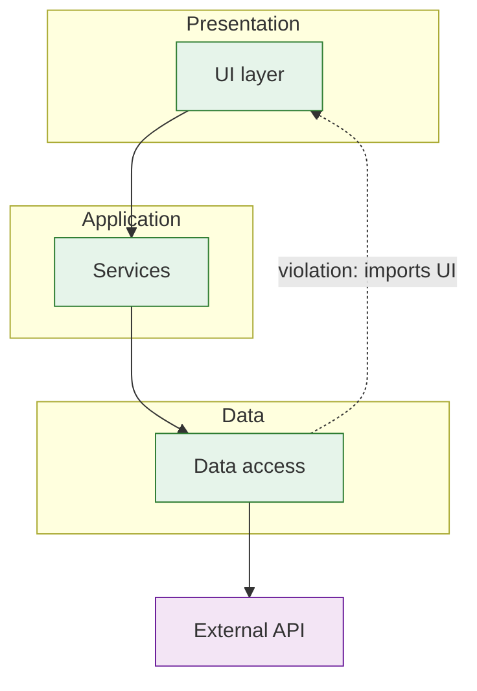

# Architecture — {{SYSTEM_OR_MODULE}}

**Workspace:** [← Overview](index.md) · [Architecture](architecture.md) · [Business Flow](flow.md) · [Risks](risks.md) · [Evidence](evidence.md) · [Source References](sources.md)

> Generated: {{DATE}} · Workflow: Architecture Analysis · Scope: {{SCOPE}}
<!-- Describe the architecture AS IMPLEMENTED. Link nodes to source per references/mermaid-diagrams.md. Workspace page `architecture.md`: put each diagram in the source-first format (ei:diagram marker + SVG image + collapsed Mermaid source) per references/engineering-workspace.md §3. Remove these comments. -->

## 1. Summary
- **Style (as evidenced):** {{e.g. feature-sliced with shared core; layered with fat controllers}} [{{EVIDENCE}}]
- **Key characteristics:** {{3–5 bullets}}
- **Main deviations from its own intended structure:** {{…}}

## 2. Components

| ID | Component | Path | Responsibility | Evidence |
|----|-----------|------|----------------|----------|
| C_example | | | | |

## 3. Component / Layer Diagram

### Source map
| Node | Source | Evidence |
|------|--------|----------|
| C_ui | `{{path}}` | |

## 4. Dependency Matrix
| From \ To | {{C_a}} | {{C_b}} | {{C_c}} |
|-----------|---------|---------|---------|
| {{C_a}} | – | {{count (example path:line)}} | |

Cycles / upward dependencies: {{…}}

## 5. Cross-Cutting Concerns
| Concern | Mechanism | Location | Consistency | Evidence |
|---------|-----------|----------|-------------|----------|
| Auth/session | | | | |
| Error handling | | | | |
| Logging/telemetry | | | | |
| Config | | | | |
| Networking | | | | |
| Persistence/cache | | | | |
| Navigation/routing | | | | |

## 6. External Integrations
| System | Purpose | Called from | Failure handling | Evidence |
|--------|---------|-------------|------------------|----------|

## 7. Runtime / Deployment View
<!-- Optional diagram from Docker/k8s/CI/IaC evidence -->

## 8. Health Observations
| # | Observation | Evidence | Location(s) |
|---|-------------|----------|-------------|

## Evidence Summary
Evidence summary: VERIFIED {{n}} · PARTIAL {{n}} · INFERRED {{n}} · UNKNOWN {{n}}
Not examined: {{…}}
To resolve UNKNOWNs: {{…}}
