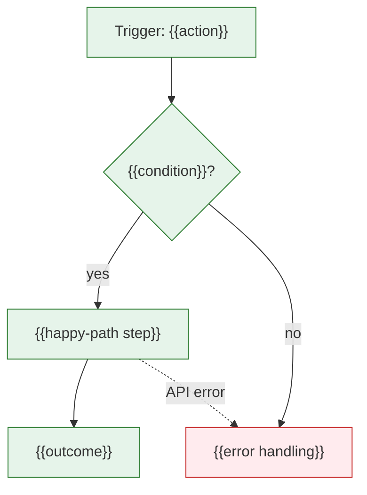
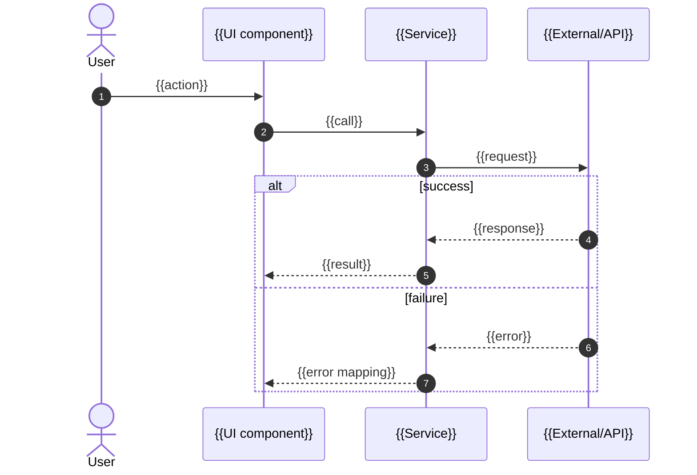

# Business Flow — {{FLOW_NAME}}

**Workspace:** [← Overview](index.md) · [Architecture](architecture.md) · [Business Flow](flow.md) · [Risks](risks.md) · [Evidence](evidence.md) · [Source References](sources.md)

> Generated: {{DATE}} · Workflow: Business Logic Tracing · Scope boundary: {{WHERE_TRACE_STOPS}}
<!-- Step IDs (S#) are also Mermaid node IDs. Rule IDs (R#) are reused by test/regression analysis. Workspace page `flow.md` / `flow-<subflow>.md`: put each diagram in the source-first format (ei:diagram marker + SVG image + collapsed Mermaid source) per references/engineering-workspace.md §3. Remove these comments. -->

## 1. Definition
- **Trigger:** {{user action / request / event / schedule}}
- **Entry point:** `{{path#symbol}}` [{{EVIDENCE}}]
- **Variants in scope:** {{roles, flags, platforms}}
- **Out of scope:** {{…}}

## 2. Summary
{{3–6 sentences in business language: what happens, key decisions, outcomes.}}

## 3. Flow Diagram

## 4. Sequence Diagram
<!-- Include when ≥3 participants interact. -->

## 5. State Diagram
<!-- Include when the flow moves an entity through statuses; else N/A. -->

## 6. Step-by-Step Trace (Source Map)

| Step | Location | Layer | Action | Inputs → Outputs | Evidence |
|------|----------|-------|--------|------------------|----------|
| S1 | `{{path:line}}` | | | | |

## 7. Logic Elements

| Element | Detail | Step | Location | Evidence |
|---------|--------|------|----------|----------|
| Condition/branch | | | | |
| Validation | | | | |
| State change | | | | |
| API call | | | | |
| Side effect | | | | |
| Error handling | | | | |
| Retry/backoff | | | | |
| Fallback | | | | |
| Concurrency guard | | | | |
| Authorization | | | | |
| Edge case | | | | |

## 8. Business Rules

| Rule | Statement | Enforced at | Duplicated/conflicting? | Evidence |
|------|-----------|-------------|-------------------------|----------|
| R1 | | | | |

## 9. Risks and Observations
| # | Observation | Severity | Location | Evidence |
|---|-------------|----------|----------|----------|

## 10. Open Questions
- {{business intent questions the code can't answer}}

## Evidence Summary
Evidence summary: VERIFIED {{n}} · PARTIAL {{n}} · INFERRED {{n}} · UNKNOWN {{n}}
Not examined: {{…}}
To resolve UNKNOWNs: {{…}}
