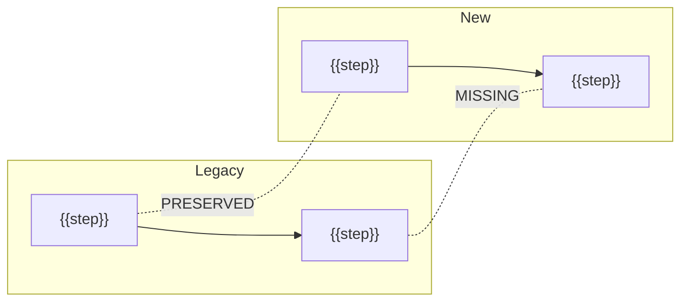

# Refactoring Comparison — {{SUBJECT}}

> Generated: {{DATE}} · Workflow: Legacy vs Refactored Comparison
> Legacy: `{{path / branch / commit}}` · New: `{{path / branch / commit}}`
<!-- Detailed per-behavior table lives in the companion behavior-mapping report. Remove these comments. -->

## 1. Verdict
**{{READY | READY WITH FOLLOW-UPS | NOT READY | INSUFFICIENT EVIDENCE}}** — {{one-sentence reason}}

<!-- READY requires: 0 MISSING, 0 unexplained CHANGED, no UNKNOWN on critical paths. -->

## 2. Scope
- **Flows compared:** {{…}}
- **Entry points:** legacy `{{…}}` ↔ new `{{…}}`
- **Known intentional changes:** {{…}}
- **Analysis method:** {{independent traces via separate subagents | sequential, legacy inventory completed first}}

## 3. Summary Counts

| Status | Count | Of which intentional | Of which unexplained |
|--------|-------|----------------------|----------------------|
| PRESERVED | | – | – |
| CHANGED | | | |
| MISSING | | – | – |
| ADDED | | | |
| UNKNOWN | | – | – |

## 4. Side-by-Side Flow

## 5. Risk Items (non-PRESERVED)

| Behavior | Status | Severity | Impact | Suggested verification |
|----------|--------|----------|--------|------------------------|

## 6. Structural Changes
| Change | Legacy | New | Notes |
|--------|--------|-----|-------|

## 7. Recommendations
1. {{…}}

## Evidence Summary
Evidence summary: VERIFIED {{n}} · PARTIAL {{n}} · INFERRED {{n}} · UNKNOWN {{n}}
Not examined: {{…}}
To resolve UNKNOWNs: {{…}}
